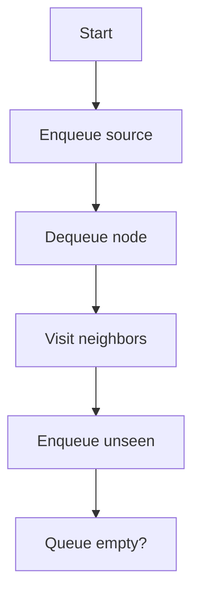
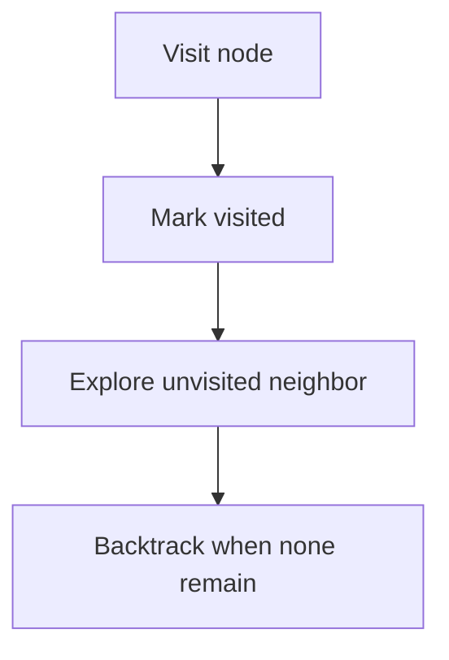
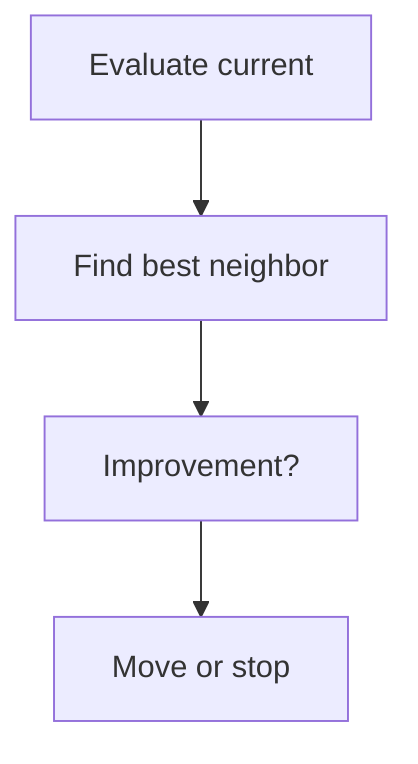
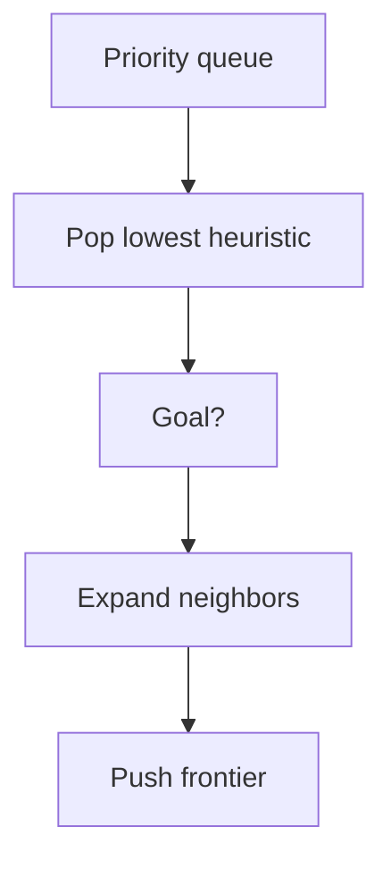
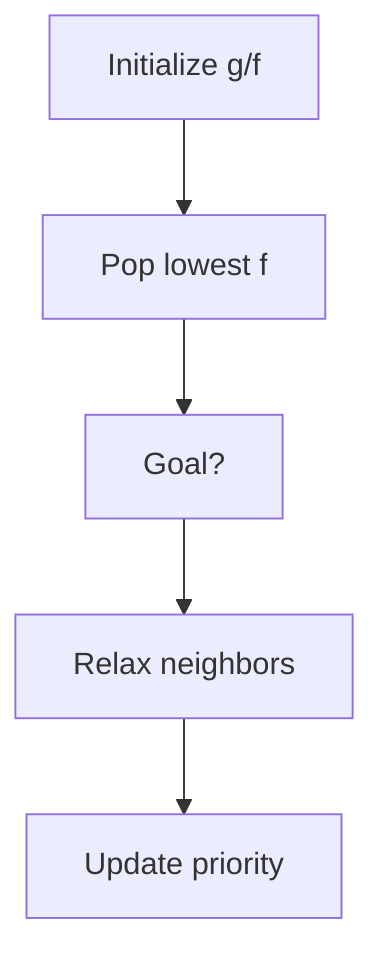

# Lab02 Uninformed and Informed Search

AI Lab practical documentation: concept, pseudocode, flowchart and complexity analysis.

## Breadth First Search (BFS)

**Objective:** Explore a graph level by level using a FIFO queue.

**Python implementation outline:**
```python
from collections import deque
def bfs(g, start):
    q=deque([start]); seen={start}
    while q:
        u=q.popleft(); print(u, end=' ')
        for v in g[u]:
            if v not in seen: seen.add(v); q.append(v)
```

**Flowchart:**


**Complexity:**
- Best case: `O(V+E)`
- Average case: `O(V+E)`
- Worst case: `O(V+E)`
- Auxiliary space: `O(V)`

**Representative output:**
```text
BFS traversal: A B C D E
```


## Depth First Search (DFS)

**Objective:** Explore one branch deeply before backtracking.

**Python implementation outline:**
```python
def dfs(g, u, seen):
    seen.add(u); print(u, end=' ')
    for v in g[u]:
        if v not in seen: dfs(g, v, seen)
```

**Flowchart:**


**Complexity:**
- Best case: `O(V+E)`
- Average case: `O(V+E)`
- Worst case: `O(V+E)`
- Auxiliary space: `O(V)`

**Representative output:**
```text
DFS traversal: A B D E C
```


## Hill Climbing

**Objective:** Move to a neighboring state with a better heuristic value until no improvement exists.

**Python implementation outline:**
```python
current = initial_state
while True:
    neighbor = best_neighbor(current)
    if score(neighbor) <= score(current): break
    current = neighbor
print(current)
```

**Flowchart:**


**Complexity:**
- Best case: `Depends on neighbors`
- Average case: `Depends on landscape`
- Worst case: `Can get stuck at local optimum`
- Auxiliary space: `O(depth)`

**Representative output:**
```text
Best local state: (x, y) = (3, 2) [illustrative]
```


## Best First Search

**Objective:** Expand the frontier node with the most promising heuristic score.

**Python implementation outline:**
```python
import heapq
frontier=[(heuristic(start), start)]
visited=set()
while frontier:
    h,u=heapq.heappop(frontier)
    if u==goal: break
    if u in visited: continue
    visited.add(u)
    for v in graph[u]:
        if v not in visited: heapq.heappush(frontier,(heuristic(v),v))
```

**Flowchart:**


**Complexity:**
- Best case: `O((V+E) log V) typical with heap`
- Average case: `Depends on heuristic`
- Worst case: `O((V+E) log V)`
- Auxiliary space: `O(V)`

**Representative output:**
```text
Goal found: G
Expanded nodes: A, C, F, G
```


## A* Search

**Objective:** Choose nodes using f(n)=g(n)+h(n), combining path cost and estimated remaining cost.

**Python implementation outline:**
```python
# f(n) = g(n) + h(n)
# Use a priority queue ordered by f-score.
# Relax a neighbor when a cheaper g-score is found.
```

**Flowchart:**


**Complexity:**
- Best case: `Heuristic-dependent`
- Average case: `Often O(E log V) with suitable implementation`
- Worst case: `Exponential worst case`
- Auxiliary space: `O(V)`

**Representative output:**
```text
Shortest path: S → B → D → G
Total path cost: 7 [illustrative]
```

> Complexity is implementation/data dependent for several AI methods. Outputs are illustrative and must be validated with the final code and dataset.