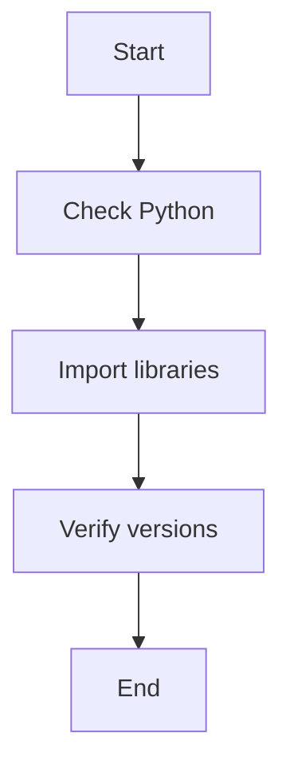
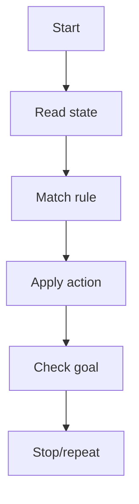
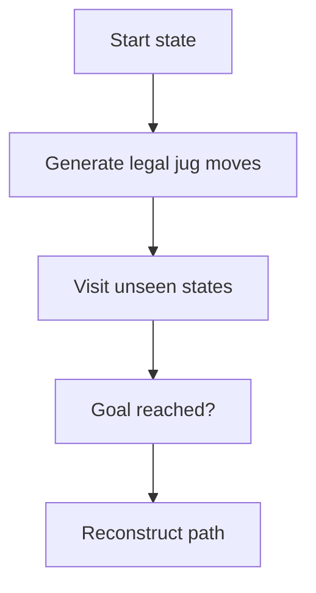

# Lab01 AI Environment and Production Systems

AI Lab practical documentation: concept, pseudocode, flowchart and complexity analysis.

## Python AI Environment Setup

**Objective:** Install/import required AI libraries and verify the Python runtime.

**Python implementation outline:**
```python
import sys
print(sys.version)
import numpy, pandas
print('NumPy:', numpy.__version__)
print('Pandas:', pandas.__version__)
```

**Flowchart:**


**Complexity:**
- Best case: `N/A`
- Average case: `N/A`
- Worst case: `N/A`
- Auxiliary space: `N/A`

**Representative output:**
```text
Python environment verified
NumPy and Pandas imported successfully
```


## Production System

**Objective:** Represent a rule-based production system using condition-action rules.

**Python implementation outline:**
```python
rules = [(lambda s: s['water'] < 4, 'fill jug A'),
         (lambda s: s['water'] >= 4, 'transfer water')]
state = {'water': 2}
for condition, action in rules:
    if condition(state):
        print('Action:', action)
```

**Flowchart:**


**Complexity:**
- Best case: `Depends on rule count R`
- Average case: `O(R) per rule scan`
- Worst case: `O(R)`
- Auxiliary space: `O(S)`

**Representative output:**
```text
Action: fill jug A
```


## Water Jug Problem

**Objective:** Find a sequence of legal jug operations to reach a target quantity.

**Python implementation outline:**
```python
from collections import deque
# State is (amount_in_4L_jug, amount_in_3L_jug)
# BFS explores fill, empty and pour operations.
# Keep visited states and parent links to reconstruct a path.
```

**Flowchart:**


**Complexity:**
- Best case: `O(V+E)`
- Average case: `O(V+E)`
- Worst case: `O(V+E)`
- Auxiliary space: `O(V)`

**Representative output:**
```text
Goal state reached: (4, 2) [example target state]
```

> Complexity is implementation/data dependent for several AI methods. Outputs are illustrative and must be validated with the final code and dataset.