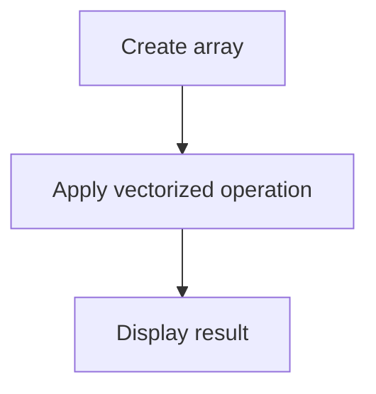
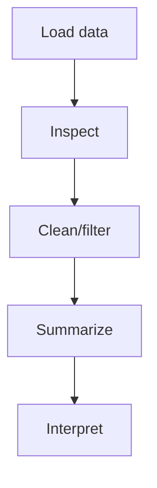
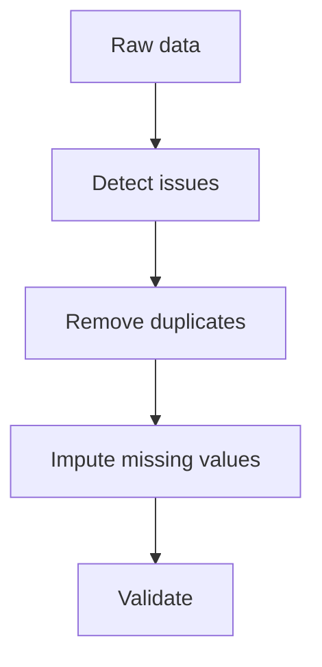
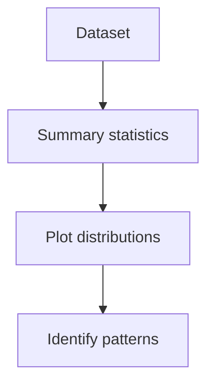

# Lab03 Data Preprocessing and EDA

AI Lab practical documentation: concept, pseudocode, flowchart and complexity analysis.

## NumPy Array Operations

**Objective:** Create arrays and perform vectorized mathematical operations.

**Python implementation outline:**
```python
import numpy as np
a=np.array([2,4,6,8])
print('Mean:', a.mean())
print('Squared:', a**2)
```

**Flowchart:**


**Complexity:**
- Best case: `O(n)`
- Average case: `O(n)`
- Worst case: `O(n)`
- Auxiliary space: `O(n)`

**Representative output:**
```text
Mean: 5.0
Squared: [4 16 36 64]
```


## Pandas DataFrame Analysis

**Objective:** Load tabular data and inspect, filter and summarize records.

**Python implementation outline:**
```python
import pandas as pd
df=pd.DataFrame({'marks':[70,85,90], 'attendance':[80,92,95]})
print(df.describe())
print(df[df['marks'] >= 80])
```

**Flowchart:**


**Complexity:**
- Best case: `O(n) for basic scan`
- Average case: `O(n)`
- Worst case: `O(n) or O(n log n) for sorting`
- Auxiliary space: `O(n)`

**Representative output:**
```text
Rows: 3
Mean marks: 81.67
Filtered rows: 2
```


## Data Cleaning

**Objective:** Handle missing values, duplicate rows and inconsistent data types.

**Python implementation outline:**
```python
df = df.drop_duplicates()
df['age'] = pd.to_numeric(df['age'], errors='coerce')
df['age'] = df['age'].fillna(df['age'].median())
print(df.isnull().sum())
```

**Flowchart:**


**Complexity:**
- Best case: `O(n)`
- Average case: `O(n)`
- Worst case: `O(n)`
- Auxiliary space: `O(n)`

**Representative output:**
```text
Missing values after cleaning: 0 [sample dataset]
```


## Exploratory Data Analysis and Visualization

**Objective:** Summarize distributions and visualize relationships before modeling.

**Python implementation outline:**
```python
import matplotlib.pyplot as plt
print(df.describe())
df['marks'].hist()
plt.xlabel('Marks'); plt.ylabel('Frequency')
plt.show()
```

**Flowchart:**


**Complexity:**
- Best case: `O(n) for summary`
- Average case: `O(n)`
- Worst case: `O(n)`
- Auxiliary space: `O(n)`

**Representative output:**
```text
Descriptive statistics generated
Histogram displayed
```

> Complexity is implementation/data dependent for several AI methods. Outputs are illustrative and must be validated with the final code and dataset.