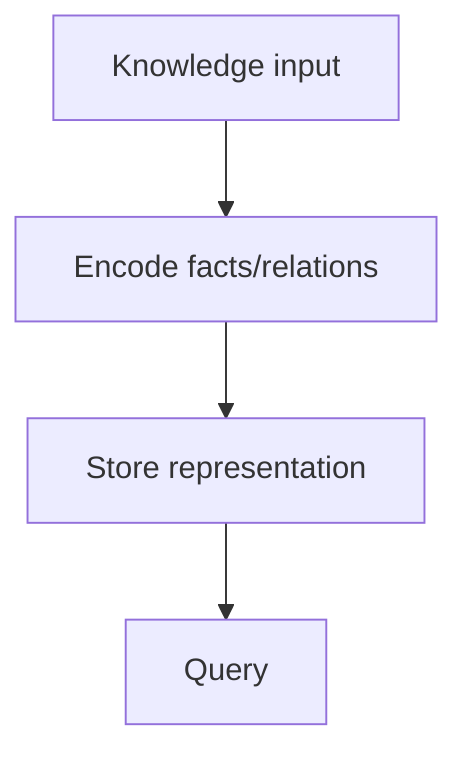
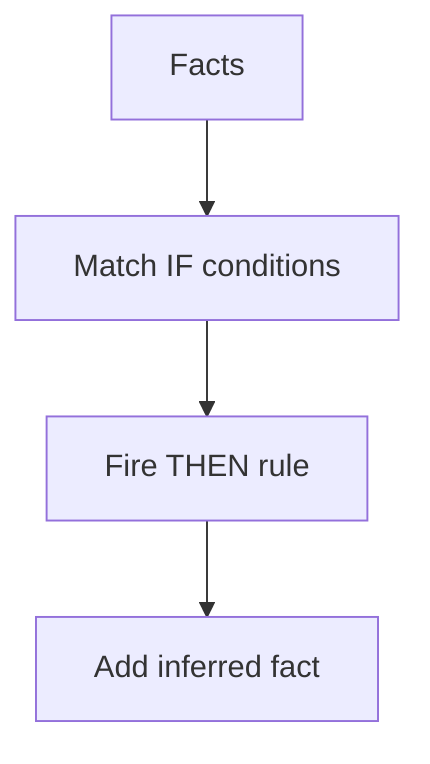
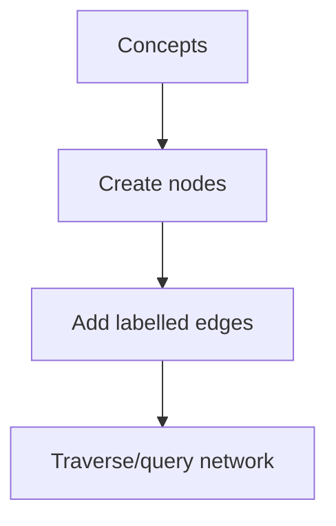

# Lab04 Knowledge Representation

AI Lab practical documentation: concept, pseudocode, flowchart and complexity analysis.

## Knowledge Representation

**Objective:** Represent facts and relationships in a structured form.

**Python implementation outline:**
```python
facts = {('Socrates','human'), ('human','mortal')}
print('Facts stored:', len(facts))
```

**Flowchart:**


**Complexity:**
- Best case: `O(F) to store facts`
- Average case: `O(F)`
- Worst case: `O(F)`
- Auxiliary space: `O(F)`

**Representative output:**
```text
Facts stored: 2
```


## Rule-Based Expert System

**Objective:** Use IF-THEN rules to infer a conclusion from known facts.

**Python implementation outline:**
```python
facts={'fever','cough'}
rules=[({'fever','cough'},'possible_flu')]
for conditions, conclusion in rules:
    if conditions <= facts: print('Inference:', conclusion)
```

**Flowchart:**


**Complexity:**
- Best case: `O(R×F) simple scan`
- Average case: `O(R×F)`
- Worst case: `O(R×F)`
- Auxiliary space: `O(R+F)`

**Representative output:**
```text
Inference: possible_flu
```


## Semantic Network

**Objective:** Represent concepts as nodes and semantic relationships as edges.

**Python implementation outline:**
```python
network = {'Dog': {'is-a':'Animal'},
           'Animal': {'needs':'Food'}}
print(network['Dog'])
```

**Flowchart:**


**Complexity:**
- Best case: `O(V+E)`
- Average case: `O(V+E)`
- Worst case: `O(V+E)`
- Auxiliary space: `O(V+E)`

**Representative output:**
```text
Dog --is-a--> Animal
Animal --needs--> Food
```

> Complexity is implementation/data dependent for several AI methods. Outputs are illustrative and must be validated with the final code and dataset.