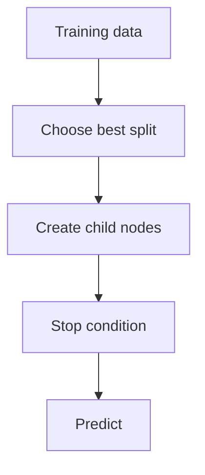
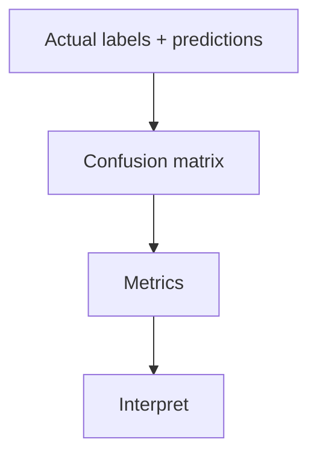

# Lab05 Decision Trees and Evaluation

AI Lab practical documentation: concept, pseudocode, flowchart and complexity analysis.

## Decision Tree Classifier

**Objective:** Train a tree that splits data using feature-based decisions.

**Python implementation outline:**
```python
from sklearn.tree import DecisionTreeClassifier
X=[[2,3],[1,1],[3,4],[2,1]]
y=[1,0,1,0]
model=DecisionTreeClassifier(random_state=42)
model.fit(X,y)
print('Predictions:', model.predict(X).tolist())
```

**Flowchart:**


**Complexity:**
- Best case: `Depends on tree depth`
- Average case: `O(n·m·log n) typical`
- Worst case: `O(n·m·log n) typical`
- Auxiliary space: `O(nodes)`

**Representative output:**
```text
Predictions: [1, 0, 1, 0] [illustrative small dataset]
```


## Model Evaluation

**Objective:** Measure classifier performance using accuracy, precision, recall and F1-score.

**Python implementation outline:**
```python
from sklearn.metrics import classification_report
actual=[1,0,1,1,0]
pred=[1,0,0,1,0]
print(classification_report(actual,pred))
```

**Flowchart:**


**Complexity:**
- Best case: `O(n)`
- Average case: `O(n)`
- Worst case: `O(n)`
- Auxiliary space: `O(k)`

**Representative output:**
```text
Accuracy: 0.80
Precision/Recall/F1 report generated
```

> Complexity is implementation/data dependent for several AI methods. Outputs are illustrative and must be validated with the final code and dataset.