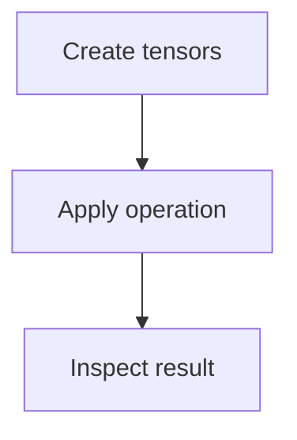
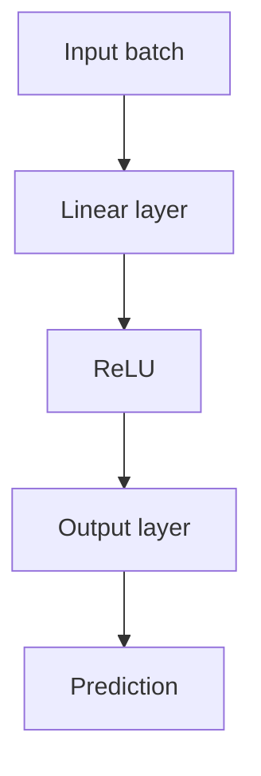
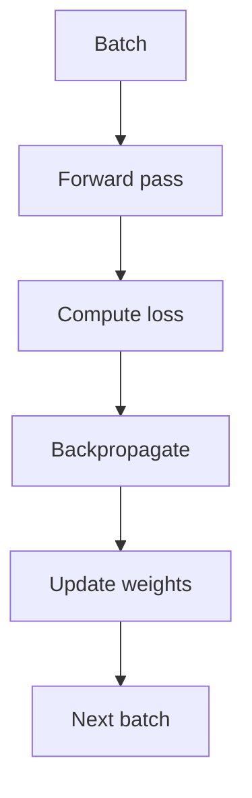

# Lab06 PyTorch Basics

AI Lab practical documentation: concept, pseudocode, flowchart and complexity analysis.

## PyTorch Tensor Basics

**Objective:** Create tensors and perform basic tensor operations.

**Python implementation outline:**
```python
import torch
a=torch.tensor([1.,2.,3.])
b=torch.tensor([4.,5.,6.])
print('Sum:', a+b)
print('Mean:', a.mean().item())
```

**Flowchart:**


**Complexity:**
- Best case: `O(n) elementwise`
- Average case: `O(n)`
- Worst case: `O(n)`
- Auxiliary space: `O(n) output`

**Representative output:**
```text
Sum: tensor([5., 7., 9.])
Mean: 2.0
```


## Neural Network with PyTorch

**Objective:** Define a small neural network, run a forward pass and inspect output shape.

**Python implementation outline:**
```python
import torch.nn as nn
model=nn.Sequential(nn.Linear(4,8), nn.ReLU(), nn.Linear(8,2))
x=torch.randn(5,4)
y=model(x)
print(y.shape)
```

**Flowchart:**


**Complexity:**
- Best case: `Depends on layers`
- Average case: `O(batch × parameters) forward pass`
- Worst case: `O(batch × parameters)`
- Auxiliary space: `O(parameters + activations)`

**Representative output:**
```text
Output shape: torch.Size([5, 2])
```


## Training Loop Basics

**Objective:** Train a simple model using loss, backpropagation and an optimizer.

**Python implementation outline:**
```python
# For each batch:
# optimizer.zero_grad()
# predictions = model(inputs)
# loss = criterion(predictions, labels)
# loss.backward()
# optimizer.step()
print('Training loop completed')
```

**Flowchart:**


**Complexity:**
- Best case: `Depends on epochs, data and model`
- Average case: `O(epochs × batches × model cost)`
- Worst case: `Same order per epoch`
- Auxiliary space: `Model parameters + optimizer state`

**Representative output:**
```text
Training loop completed [after configured epochs]
```

> Complexity is implementation/data dependent for several AI methods. Outputs are illustrative and must be validated with the final code and dataset.